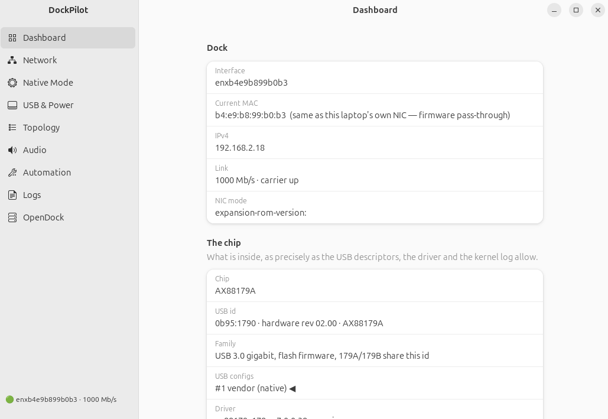
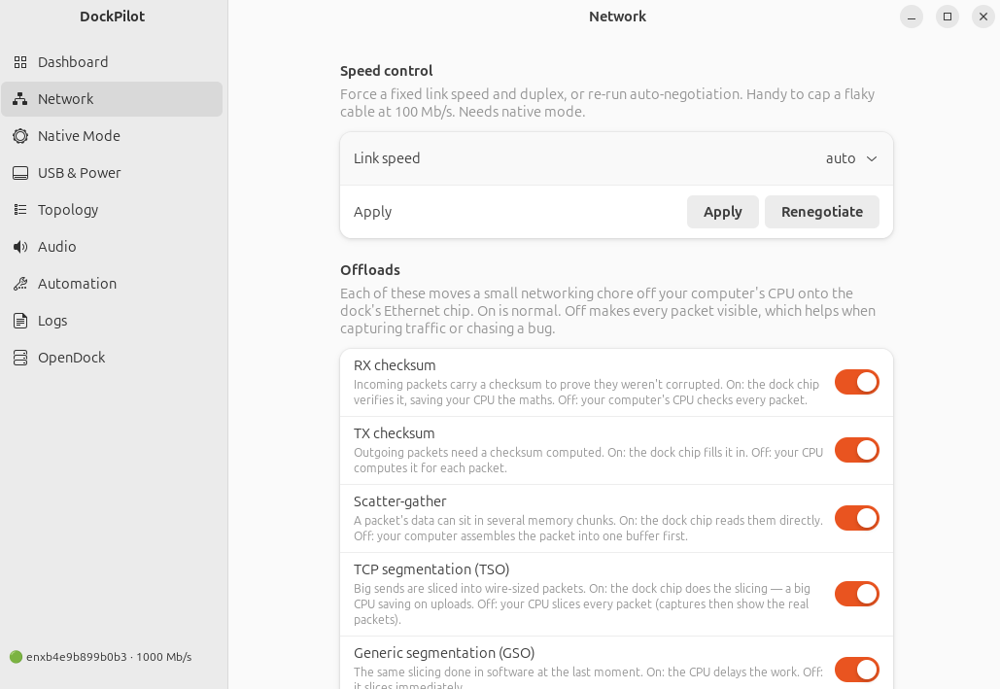
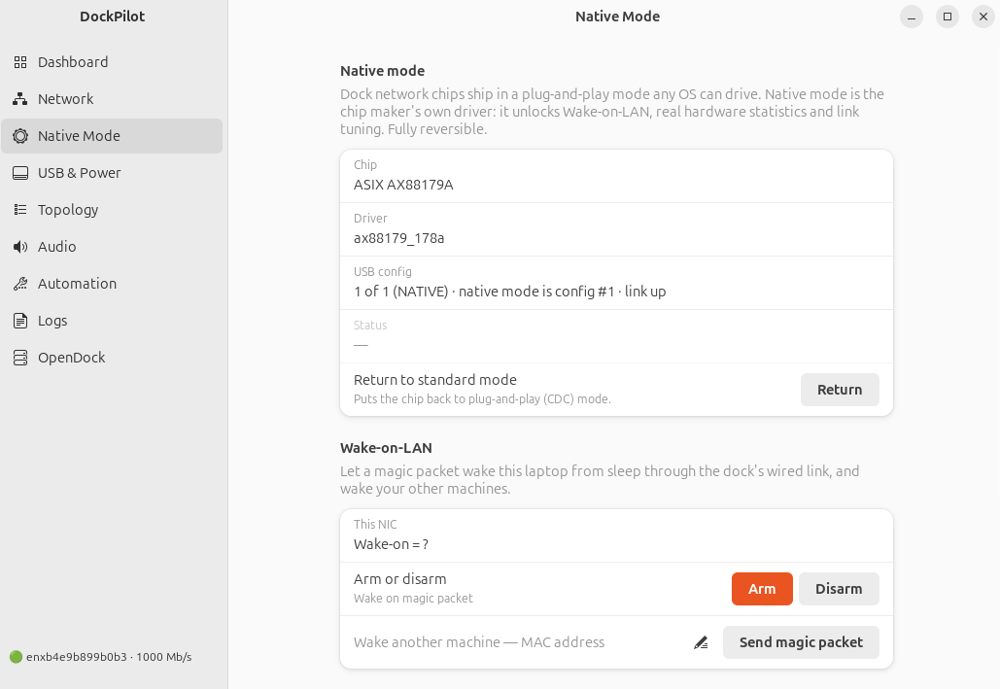
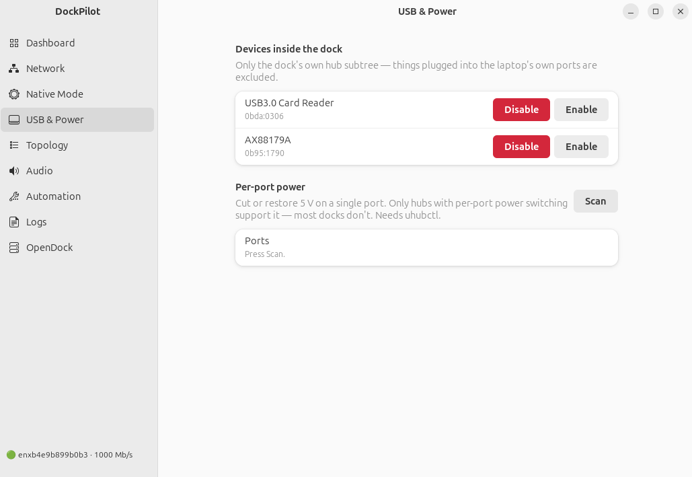
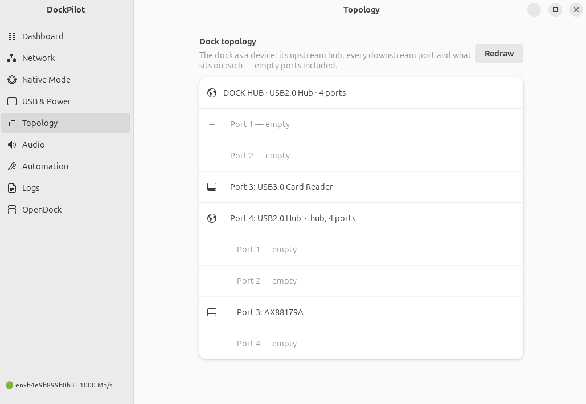
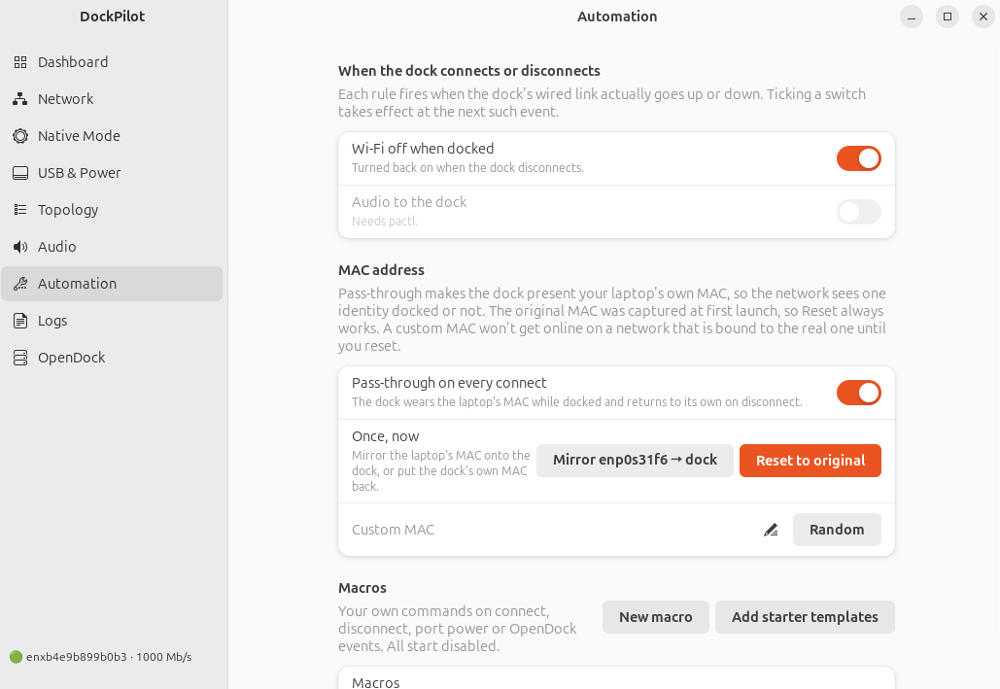

# DockPilot

*By [opendocktech.com](https://opendocktech.com). Free software, for Ubuntu.*

A vendor-neutral **admin console for USB-C / Thunderbolt docks and hubs on Ubuntu.**

Docks hide most of what their hardware can actually do, and on Linux no vendor gives you a tool
to change that. DockPilot works out what's inside your dock, unlocks what it safely can, shows you
what's really going on, and lets you control it — see more on [OpenDockTech](https://opendocktech.com)
for Docking Stations that are fully compatible with this software.



## Screenshots

| | |
|---|---|
| **Dashboard** — the dock's NIC, exact chip, live link |  |
| **Network** — link speed and offloads, explained in plain words |  |
| **Native mode** — unlock the chip maker's driver, Wake-on-LAN |  |
| **USB & Power** — enable/disable devices behind the dock, port power |  |
| **Topology** — the dock's hubs, ports and what's on each |  |
| **Automation** — rules, MAC pass-through, your own macros |  |

---

## What it does

- **Unlocks hidden features.** Many dock network chips ship in a limited plug-and-play mode.
  DockPilot detects this and offers a one-click, reversible switch to the manufacturer's native
  driver — then checks it actually worked, and puts things back if it didn't.
- **Wake-on-LAN.** Wake your machine over the dock's wired link, and send magic packets to wake
  other machines on your network.
- **Live dashboard.** Throughput, link health, latency, and what chip your dock actually contains.
- **Names the chip.** Says what is really inside, from the vendors' own driver tables — the exact
  Realtek part and silicon revision when the kernel names it (RTL8153A-3, RTL8156B-2 …), the ASIX
  generation from its hardware revision (AX88179 vs 179A vs 279), rebrands sold under Lenovo, Apple,
  Microsoft, TP-Link and others, and whether the dock can carry your laptop's own MAC through.
- **Dock map.** A live diagram of the dock's internals — its hubs, ports, and what's plugged into
  each — scoped to the dock, not your laptop.
- **Per-device control.** Enable or disable individual devices behind the dock; switch port power
  where the hardware supports it.
- **Macros.** Run your own commands when the dock connects or disconnects. No assumptions about
  your setup — you write the commands; five editable templates get you started, and macros can be
  scoped to a specific dock.
- **System Snapshot.** One button writes a single diagnostic file (chips, drivers, USB layout, link
  stats, logs) with IPs and hostname redacted — ready to attach to a bug report.
- **Automation.** Turn Wi-Fi off when you dock, mirror your laptop's MAC, switch audio to the dock.
- **Tidy-up tools.** Clean up leftover network profiles, inspect chip configuration (read-only),
  and tune link speed and offloads where the hardware allows.
- **OpenDock.** A dock with the OpenDock board inside stores the desk's network settings and
  your own rules, and gives them to whichever laptop plugs in. It also has its own web page and
  takes firmware updates from a file. See [OpenDock](#opendock) below.

## Tested hardware

Every device below was tested on a real machine.

| Device | NIC chip | Ships as | Native mode result |
|---|---|---|---|
| Wavlink WL-UMD05 REV.C | ASIX **AX88179A** | `cdc_ncm` | ✅ unlocks, link comes up |
| UGREEN Revodok Pro (10-in-1) | ASIX **AX88179B** | `cdc_ncm` | ⚠️ engages, but wired link won't come up — auto-reverts, diagnosed |
| TP-Link UE300C | ASIX **AX88179B** | `cdc_ncm` | ⚠️ same as above — diagnosed, reverts |
| Anker USB-C Gigabit adapter | ASIX **AX88179B** | `cdc_ncm` | ⚠️ same as above — diagnosed, reverts |
| uni USB-C Hub 6-in-1 | Realtek **RTL8153** | `r8152` | ✅ already native out of the box |
| TP-Link UE302C (2.5G) | Realtek **RTL8156** | `r8152` | ✅ already native; advertises 2500baseT/Full |
| MOKiN / C-Smartlink DK1903A (Thunderbolt 4, 12-in-1) | Realtek **RTL8156B** | `r8152` | ✅ already native; works fully over Thunderbolt |
| ASIX AX88772B USB-A adapter (10/100) | ASIX **AX88772B** | `asix` | ✅ single USB config — nothing to unlock; correctly offers no native mode |
| Belkin USB-C to 2.5GbE (USB-IF certified) | Realtek **RTL8156B** | `r8152` | ✅ already native; **links at a real 2500 Mb/s** |
| Luonanava 8-in-1 USB-C Hub | Realtek **RTL8152** (10/100) | `r8152` | ✅ already native; whole tree runs at USB 2.0, links at 100 Mb/s |
| LINOVISION PoE→USB-C Converter | Realtek **RTL8152** (10/100) | `r8152` | ✅ already native; single device, no hub — simplest topology tested |
| Lemorele 10-in-1 | *(no NIC)* | — | ✅ graceful: "no network chip", topology still drawn |

---

## OpenDock

Most docks are anonymous boxes. A dock built with the OpenDock board from
[opendocktech.com](https://opendocktech.com) answers questions over a USB serial port, and from
firmware 0.6 it stores the settings of the desk it sits on. Plug a laptop in and DockPilot reads
those settings and applies them; unplug it and they are removed again. The dock stores; DockPilot
does the work on the laptop.

The **OpenDock** page has four tabs:

- **Dock.** What it is, how it's doing (health, temperature, power on the host port, lifetime
  counters), where its own page is (from firmware 1.0 the dock is also a tiny web server on the
  cable: `http://opendock.local`, any browser, any computer, no app), a *Firmware → Update…*
  button that sends a new firmware file to the dock, and *At this desk*: what the dock handed to
  this laptop — VLAN, MTU, address, DNS, time, proxy, VPN — applied while docked.
- **Setup.** What is kept in the dock: the desk tag, the nine desk options (validated by the dock
  itself), and key storage — up to 64 named values for anything else, read and written by
  scripts with `opendock get|set|del <name>` and `opendock keys`, or by anything that can fetch a
  URL: `http://opendock.local/key/<name>`. *Export* writes the whole desk as a text file; *Apply from file* sends one
  back in a single write, so fifty docks are provisioned from one file.
- **Rules.** This laptop at this desk: Wi-Fi off while docked, sound through the dock, lock or
  mute on undock, touchpad off, use the desk's VPN or proxy, show the icon in the top bar; your own
  commands on dock and undock; a saved configuration (screens, sound, keyboard, VPN) restored every
  time you dock, saved again on undock if you like. All of it is stored in the dock under a seat
  key only your laptops know — the dock never learns who you are. *Show my key* gives six words to
  type into DockPilot on your other laptop, which then is the same seat at every dock.
- **Records.** Hours docked per day from the dock's own log, the log file (export, clear), and the
  configuration record an inventory system receives (`opendock-report/2`, also kept up to date in
  `~/.cache/dockpilot/opendock-<serial>.json`).

A dock with older firmware still shows Dock and Records; Setup and Rules say what is missing.

**Firmware updates** (firmware 1.0 and later): the dock keeps two copies of its firmware. An
update goes into the copy that is not running, the dock restarts with it, and if the new firmware
does not start cleanly the dock comes back on the old one by itself. The same works from the
dock's own page, so a Windows or Mac laptop can update a dock too. Firmware files, the developer
guide and the docks themselves come from [opendocktech.com](https://opendocktech.com).

Two macro triggers, `opendock_connect` and `opendock_disconnect`, carry the dock's identity
(`DOCK_SERIAL`, `DOCK_TAG`). Needs pyserial.

The same code is a command-line tool:
`opendock list | status | desk | get <name> | export | import <file> | log | set name "…" | watch`
(`python3 dockpilot/opendock.py` from a checkout).

Want to build a dock that speaks it, or script one yourself? The protocol fits on a few pages:
[PROTOCOL.md](PROTOCOL.md).

## Install & run

**Ubuntu (recommended) — the .deb.** Download `dockpilot_1.2-1_all.deb` from the
[latest release](https://github.com/dinnerisserved/dockpilot/releases), double-click it (App
Center → **Install**) or:

```bash
sudo apt install ./dockpilot_1.2-1_all.deb
```

Log out and in once. You get DockPilot in the app menu, a background service that runs your
rules with no window open, a **Dock** tile in the top-right menu, and OpenDock serial access
with no group changes. Uninstall: `sudo apt remove dockpilot`.

**pip — the app alone.** For other distributions, or if you don't want the system pieces:

```bash
sudo apt install python3-gi python3-gi-cairo gir1.2-gtk-4.0 gir1.2-adw-1 ethtool   # or your distro's names
pip install "dockpilot[opendock]"
dockpilot
```

Same app, same code. No top-bar tile, no autostart, and a password dialog when it changes
something — those three come from the .deb.

**From source.** `git clone https://github.com/dinnerisserved/dockpilot.git && cd dockpilot && python3 dockpilot/dockpilot.py`
(same system packages as pip). Build your own .deb with `sh packaging/build-deb.sh`.

Optional extras that unlock more panels: `sudo apt install uhubctl usbutils network-manager`.

## Configuration

Settings live in `~/.config/dockpilot` (rules, remembered docks, the original MAC, OpenDock logs,
and `seat_key` — the six words that are your seat at every OpenDock; copy that file to keep them).
Nothing personal ships with the project; delete that folder for a clean slate.

---

## Notes

Detail for people who want it — skip unless you're digging in.

**The pieces.** Four files. `dockpilot/dockpilot_core.py` is the engine (detection, chip tables,
actions, rules, OpenDock) and, run on its own, the background service that writes
`~/.cache/dockpilot/status.json` for the top-bar tile. `dockpilot.py` is the window (GTK 4 /
libadwaita). `dockpilot_helper.py` is the root helper. `opendock.py` is the protocol client. The
tile itself is a 100-line GNOME Shell extension that only reads that file and launches the app.

**Privileges.** DockPilot never runs as root. `dockpilot_helper.py` does, through polkit, with a
fixed list of operations (offloads, speed, MAC, Wake-on-LAN, USB enable/disable, port power, the
native/standard switch) and no shell. The .deb lets the user at the screen use it without a
password, the way NetworkManager does for its own settings; `tests/test_helper.py` checks every
allowed operation and fifty ways of asking for something else.

**Offloads.** Checksums, segmentation and receive merging can be done by your CPU or by the dock's
Ethernet chip. Linux turns on everything the chip supports the moment it is plugged in, so "all
on" is the default and the right setting for nearly everyone. The switches exist for two cases:
packet captures (offloads make Wireshark show unsliced data with empty checksums) and a chip
that gets a checksum wrong. Changes last until the dock is unplugged.

**ASIX vs Realtek.** The whole Realtek ladder — **RTL8152** (10/100), **RTL8153** (gigabit) and
**RTL8156/8156B** (2.5G) — runs its native driver happily, and they usually arrive that way already. Current-generation **ASIX AX88179B** parts are a different story:
the native driver binds, but the Ethernet link never comes up. Only the older **AX88179A** works.
Four devices from three brands reproduce this here, and it's independently reported on the Linux
kernel mailing list ("ax88179_178a … Link status is: 0"). DockPilot unlocks the chips that work and,
for the ones that don't, engages native mode, spots the dead link, reverts, and remembers the
verdict so it won't retry blindly.

**How native-mode unlock works.** USB devices can present multiple *configurations*. Many
ASIX/Realtek dock NICs ship on a generic CDC config (driven by `cdc_ncm`/`cdc_ether`), which
hides the chip's advanced features. Their native/vendor config exposes everything, driven by
`ax88179_178a` (ASIX) or `r8152` (Realtek). DockPilot switches by writing the device's
`bConfigurationValue` in sysfs, then re-checks the driver and link, and reverts if the link
doesn't come up. Fully reversible — unplugging the dock always returns it to standard mode.

**Where the chip names come from.** Realtek publishes its `r8152` driver source. Its USB device
table, the dock ids it names, its MAC pass-through rules and the way it finds the native
configuration (by interface class — "the vendor mode is not always config #1") are all in there,
and DockPilot reads the same facts from sysfs without that driver installed. The exact part and
silicon revision come from the firmware file the in-kernel `r8152` loads (`ethtool -i` shows it as
`rtl8153a-3 v2 …`); a chip still in CDC mode only shows what its product id says. Parts with
three configurations (product id `8053`, hardware rev `e0.xx`: NCM, ECM, then native as #3) unlock
correctly now that the native config is found rather than assumed.

**`r8152-cfgselector`.** Recent kernels ship a helper that performs the same
`bConfigurationValue` switch for Realtek NICs automatically at plug-in. So modern Realtek
devices increasingly arrive already-native, and DockPilot's unlock is most valuable on
**ASIX**, where no such helper exists.

**Thunderbolt docks.** The TB4 dock tested tunnels **USB** over Thunderbolt rather than
presenting a PCIe NIC, so DockPilot manages it exactly like a USB-C dock — no special
handling needed. It's also the only dock tested where `fwupd` sees dock-side firmware (Intel
USB3.0 Hub, USB4 Retimer); cheap USB-C docks show nothing. It needs a genuine Thunderbolt
cable — a normal USB-C cable silently drops it to USB 2.0 with no error.

**2.5G links.** An RTL8156 only *links* at 2.5G if the other end is 2.5G too; on gigabit
infrastructure it negotiates down to 1000Mb/s. The Belkin adapter confirmed a real 2500Mb/s link.
Note that `ethtool`'s advertised-modes output isn't always trustworthy — one dock claimed
10baseT-only on a 2.5G chip while sysfs correctly reported the real speed, so DockPilot reads
speed from sysfs.

**EEPROM in practice.** Across nine devices, only one exposes a readable EEPROM: the older ASIX
**AX88772B**, where the layout is fully decodable — MAC at `0x0008`, VID/PID at `0x0048`, vendor
strings at `0xC0`. Everything else reads back as all-`FF` (the chip uses one-time eFuse) or reports
no EEPROM access at all. Writing was rejected on every device tested; on the AX88772B the driver
logs *"Failed to enable software MII access"*, so `ethtool -E` can't reach the write path.
DockPilot therefore treats EEPROM as **read-only**, which is all it ever claimed to do.

**Built on.** The Linux `ax88179_178a` and `r8152` drivers and the device tables in Realtek's
and ASIX's published driver sources; `uhubctl` for per-port power; `ethtool`, `fwupd`, and the
sysfs USB/net interfaces. What DockPilot adds is the synthesis: detect the chip, attempt the
unlock, verify it works, degrade honestly when it doesn't, and present it in a GUI.

**Status.** The generic tool (chip naming, native mode, offloads, automation) is complete. What
grows from here is the OpenDock side, as the docks do — follow [opendocktech.com](https://opendocktech.com).

## License

See [LICENSE](LICENSE). Made by [opendocktech.com](https://opendocktech.com) — hello@opendocktech.com.

## Disclaimer

DockPilot changes low-level USB/network device state on hardware you own. Mode switches are
reversible and the app is careful, but you use it at your own risk. It never writes firmware
or EEPROM.
